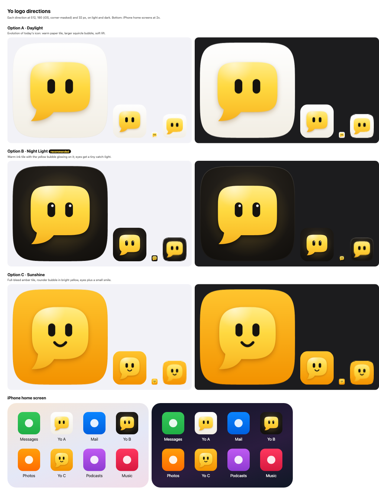

# Yo logo (Yo Phone app icon)

The Yo mark is a yellow speech bubble with a face (two eyes). This refresh keeps that identity and
polishes it for the home screen. It has only shipped in the phone app (`phone/icons/*`) so far.



## What changed in the mark (all options)

- **Body:** a superellipse ("squircle") instead of a hand-drawn rounded rectangle. It's a bit wider
  than it is tall, and the curvature is even all the way round.
- **Tail:** grows out of the lower left, with its tip lined up under the bubble's left edge, so the
  bubble and tail read as one shape.
- **Eyes:** tall pills, a little above the body's centre. The tail adds weight at the bottom, so this
  makes the face look centred. They're bigger than before so the face still reads at 32 px.
- **Colour:** a short vertical ramp around the brand yellow `#FFD43B`, from `#FFEC85` to `#F4AE1C`,
  plus one soft top-left sheen. The ink is a warm near-black (`#16130E`), so it never looks blue
  next to the yellow.
- **Small sizes:** at 64 px and below there's a separate small version (used for the favicon). It has
  no shadow or gloss, and the bubble and eyes are slightly larger.

## The three directions

| | Name | Idea | Strengths | Weaknesses |
|---|---|---|---|---|
| A | Daylight | Warm paper tile, refined bubble with a soft lift (closest to today) | Familiar, friendly | Pale tile disappears on light wallpapers and in light browser tabs; little emphasis |
| B | Night Light | Warm-ink tile, glowing yellow bubble, catch-light in the eyes | Most contrast; premium; the yellow pops; strong favicon | Tile edge is quieter on dark wallpapers (the rim light helps) |
| C | Sunshine | Full-bleed amber tile, rounder bubble, eyes plus a smile | Loudest and most "yellow" | Yellow on amber is low contrast; smile turns to mush at 32 px; the round bubble reads less like a chat |

## Pick: B, Night Light

- **More emphasis.** The owner asked for more emphasis. A dark tile turns the yellow bubble into a
  light source, so it's the most noticeable icon on a home screen without changing the brand colour.
- **Works on light and dark.** It's strongest on light wallpapers, where A fades out. On dark
  wallpapers the warm glow and a faint top-lit rim (on the rounded `any` icons) keep it apart from
  the background.
- **Crisp at 32 px.** It has the clearest favicon: a bright shape on dark, with eyes you can still
  make out.
- **Same mark everywhere.** `logo.svg` (the bare bubble, used inside the app as the avatar and hero
  image) is the same mark as before, just refined. The app UI still looks the same, only crisper.

## Files (`phone/icons/`)

| File | Size | Notes |
|---|---|---|
| `logo.svg` | vector | Bare mark on transparent (in-app avatar/hero, manifest `any` SVG) |
| `apple-touch-icon.png` | 180 | Full-bleed square, **RGB with no alpha** (iOS rounds the corners itself) |
| `icon-512.png`, `icon-192.png` | 512 / 192 | Manifest `any`: our own squircle tile, transparent corners |
| `icon-maskable-512.png` | 512 | Full-bleed square, RGB. The mark is scaled to fit inside the 80% safe-zone circle (with a 4% margin) |
| `favicon-32.png` | 32 | Small version on the rounded tile |

The file names haven't changed, so `phone/manifest.webmanifest`, `phone/index.html` and `phone/sw.js`
work as they are. (After deploy, `sw.js` serves the cached icon once, refreshes it in the background, and
shows the new one on the next load. iOS keeps the home-screen icon it saved at install time, so you
only see the new icon after removing the app and adding it to the home screen again.)

## Regenerate

```sh
CI=true pnpm install --frozen-lockfile                   # once: Playwright + Chromium
node scripts/brand/render-icons.mjs                      # write phone/icons/* (direction in CHOSEN)
node scripts/brand/render-icons.mjs --preview            # same, plus /tmp/yo-logo/final-preview.png
node scripts/brand/render-icons.mjs --sheet /tmp/yo-logo # all 3 directions, comparison sheet,
                                                         # docs/brand/options/*.svg, docs/brand/logo-options.png
```

All the geometry and colours live in `OPTIONS` in `scripts/brand/render-icons.mjs`. The script builds
SVG strings and draws them onto a canvas in headless Chromium. It then writes PNGs with a tiny built-in
encoder, so opaque icons come out as true RGB. To switch direction, change `CHOSEN` and rerun.

## Later: rolling the mark out to the desktop app and site (not done here)

1. **Desktop app** (`apps/desktop` build icons, `apps/web/public/favicon.svg` and `icon-512.png`):
   - Add a target to the script that writes the rounded tile at 1024 for the macOS `.icns` and the
     Windows `.ico` sources, plus `apps/web/public/icon-512.png`.
   - Use the bare-mark SVG as `apps/web/public/favicon.svg`. The `yo-av` avatar classes in the app
     animate the in-app mark, so keep those class hooks (`yo-av-look`, `yo-av-blink`) on the eyes
     group if the living avatar is meant to share this geometry.
2. **Site** (`site/assets/logo.svg`, `favicon-32.png`, `apple-touch-icon.png`, `brand-lockup.svg`, `og.png`):
   - Reuse the same outputs.
   - Rebuild the lockup and the OG image so the wordmark sits next to the new bubble.
3. **Do it as one PR per surface**, with before/after screenshots. Then the brand yellow in
   `apps/web/src/styles.css` (`--brand`) can stay as it is, because the mark's mid-tone is still
   `#FFD43B`.
